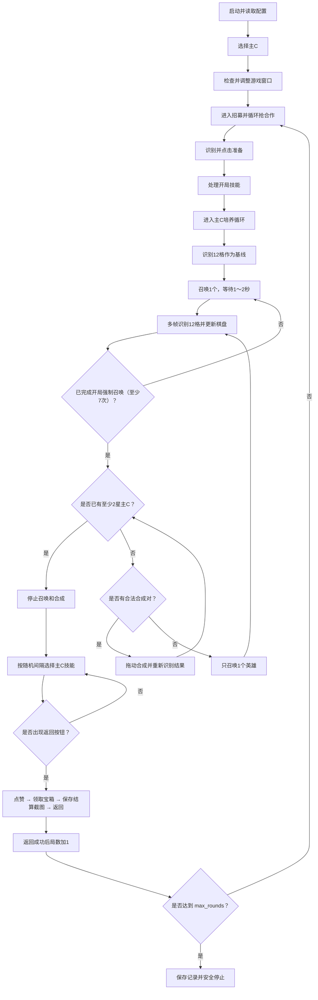
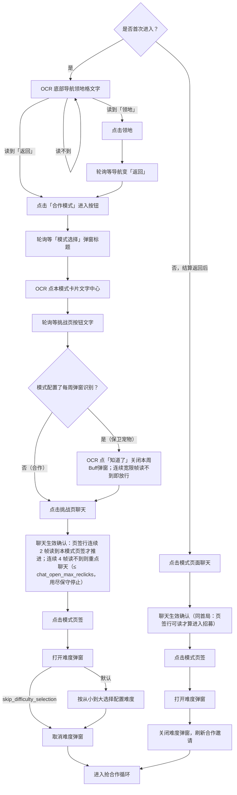

# 自动化执行流程

本文档记录已经确认的端到端自动化流程，是后续状态机设计和代码实现的流程基准。具体游戏事实见 [游戏规则知识库](game-rules.md)，技术结构见 [架构设计](architecture.md)。

## 启动配置

脚本启动时从配置文件读取：

- `run.mode`：本次组队对局模式（`coop` 合作模式 / `pet` 保卫宠物），默认 `coop`；命令行 `wlxq-bot run coop --mode pet` 可覆盖本次运行。模式差异统一由 `mode_profiles.<mode>` 档案承载，详见下文「保卫宠物模式」一节。
- `max_rounds`：本次最多完成的合作局数；命令行 `wlxq-bot run --max-rounds N`（简写 `-n`）可覆盖本次运行。
- `max_steps_per_round`：单局调度循环的最终安全保险；返回验证成功、局数增加后重置，不限制多局累计步数。
- `minimum_summon_count_before_skills`：允许进入局内技能选择前必须完成的最低召唤次数，当前为 5。
- `initial_board_capacity`：合作模式开局开放格数，当前已确认为 7。
- `target_star_level`：停止召唤和合成的主 C 最低星级，当前为 2。
- `summon_recognition_delay_min/max`：每次召唤后等待英雄落位再识别的区间，当前方案为 1～2 秒。
- `board_recognition_frames`：每次培养决策连续识别棋盘的帧数，默认 10。
- `home_return_confirm_frames`：等待开局期间连续识别到首页标记的确认帧数，达到即判定本局被取消/被踢回首页，默认 2。
- `match_start_timeout_seconds`：点击准备后等待对局界面的超时（秒），超时按本局未开始处理、重新进入招募，默认 120。
- `leave_team_after_seconds`：组队大厅等待房主开始超过该秒数（识别到【退队】按钮）即主动退队重新抢合作，默认 20。
- `window_foreground_wait_seconds`：窗口非前台/最小化时的最长挂起等待（秒），期间任务不发送任何输入（点击会落到当前前台窗口），对局自动进行、切回后从当前进度继续；超时才保守停止，默认 300。主循环和抢合作阶段共用此策略。
- `refocus_when_idle` / `refocus_idle_seconds`：挂起期间检测系统鼠标/键盘空闲（GetLastInputInfo，全系统），无输入超过 `refocus_idle_seconds`（默认 20 秒）即认为用户没用电脑，自动把游戏窗口切回前台继续任务；用户正在操作时不抢焦点。激活失败按 5 秒节流重试。主循环和抢合作阶段共用此策略。
- `coop_difficulties`：首次招募时需要勾选的难度范围，命令行可以覆盖。
- 主 C 档案策略字段（`main_c_profiles.<主C>`，当前仅强袭启用）：`avoid_main_c_merge`（合成尽量不合并主C，保数量）、`topup_after_skill_selections` / `topup_hero_count`（局内选满 N 次技能后回培养把主C数量补到目标以上）。
- `skip_difficulty_selection`：游戏本次会话已手动选过难度时，首局招募只跳过勾选难度等级，弹窗仍开/关一次刷新邀请；命令行 `--skip-difficulty-selection` 可覆盖。
- 所选主 C 的技能卡英雄图标模板 `skill_icon_templates`。
- 队友英雄技能卡图标 `teammate_skill_icon_templates`（本局阵容其余三名英雄）：主C图标未命中但识别到任一队友图标时，立即随机选卡。
- 识别阈值、等待时间和安全重试参数。

用户启动时只需要选择本次主 C，当前优先支持强袭和猴子。随后脚本检查游戏窗口；若客户区尺寸与本机配置（`configs/local.yaml`）不一致，`run.auto_adjust_window`（默认开启）会自动把窗口调整到目标尺寸（等价 `wlxq-bot adjust-window`），调整后仍不一致才报错停止；关闭该开关则退回旧行为——停止并提示手动执行 `wlxq-bot adjust-window`。未配置 `local.yaml` 时无目标尺寸，不做调整，模板包按显示器分辨率选择。

## 调度循环的截图时效

`safety.frame_ttl_ms`（默认 3000，实机定案 15000）约束「截图 → 识别 → 决策 → 执行」全程：决策所依据的画面超过时效后不再执行输入。识别耗时随机器状态波动（高负载、省电模式、多模板匹配），而**机器慢不视为故障**（实机 2026-09-14：机器高负载时领地入口单帧识别 19~61 秒，15 秒时效把全部决策拒之门外导致无进展停止）：决策超龄时先把生效时效翻倍放宽（封顶 `safety.frame_ttl_max_ms`，默认 90000），放宽后本帧决策仍新鲜就继续执行——慢机上动作只是变慢，WARNING 日志注明放宽值与上限；决策重新在基础时效内新鲜后生效时效自动回落（DEBUG 日志，滞回设计避免负载在阈值附近抖动时反复放宽/回落）。放宽也无济于事（识别比上限还慢）才丢弃本轮决策、重新截图重试（难度弹窗等静态界面晚几秒重试仍有效），这不算动作失败、不消耗安全失败预算，WARNING 日志输出截图/识别的分段耗时；连续多轮（当前 3 轮）超上限才保守停止。

合作模式当前已确认 `initial_board_capacity = 7`；游戏门禁为累计召唤 5 次才能使用局内「选择技能」，且每累计召唤 5 次自动开放 1 个新格，因此第 5 次召唤后开放格数变为 8。自动化配置 `minimum_summon_count_before_skills = 7`（2026-09-10 用户决策）：开局强制召唤满 7 次填满 7 个开放格后，才进入棋盘决策和技能选择。程序不需要通过视觉复核开放格数。

## 总体流程



## 邀请者模式组队（run --invite，主C猴子）

邀请者发起合作等待帮助者加入，与「抢合作」互斥；结算返回合作挑战页后重走邀请链。详细设计见 `docs/superpowers/specs/2026-09-21-initiator-monkey-design.md`。

```text
INVITE_CLICK    5 步邀请点击链（每步动作后验证）：
                邀请按钮 → 一键邀请(弹窗层) → 好友页签 → 公会招募 → 一键邀请(好友页)
INVITE_WAITING  轮询「邀请」文字（invite_text ROI，限域 OCR）：
                可见 = 无人进房；超 reinvite_after_seconds 重走点击链
                （连续 max_empty_reinvites 次保守停止）
                不可见 → 复检一次防遮挡误判 → 确认进房：
                  点邀请位置弹帮助者信息层 → OCR 关卡进度（helper_stage_progress）
                  → 点 ×（close_button）关闭弹层
                  ≥ min_stage_progress(475) → INVITE_START
                  < 阈值 → 点【请离】(invite_kick) → INVITE_COOLDOWN
                  进度读取失败 → 重试后保守停止（绝不盲踢/盲开局）
INVITE_START    轮询开局按钮双态模板（invite_start_button_area）：
                「已准备」→ 点击开局 → ENTER_MATCH（此后与抢合作路径合流）
                「未准备」→ 继续等（ready_timeout_seconds 超时请离重来，0=一直等）
                按钮消失且邀请文字重现 → 帮助者退出，回 INVITE_WAITING
INVITE_COOLDOWN 等 kick_cooldown_seconds → 回 INVITE_CLICK 重发邀请
```

### 邀请者局内差异（spec §5）

- 门禁：主C ≥1 星（`target_star_override`）且天使、雪姬在场（`required_lineup_heroes`）；
- 开局召唤 5 次（`opening_summons`）后点「准备完成」（固定坐标，动作后验证）；
- 凑阵容：每批召唤 `summon_batch_size`(3) 个；棋盘满时安全合成腾格子
  （保留数 `hero_keep_counts` + 3 星软避让 `forbid_star3_merge`：产物 ≥3 星一律不合，
  占满也不合）；
- 卡住（满盘+无安全合成+阵容不齐）：变身碰辅助，牺牲顺序 `transform_sacrifice_order`
  （死骑→雪姬，受保留数约束）；变身耗尽 → 干等到对局结束（重置无进展计数）。
```

## 动作后验证与对局结束信号

严格输入动作（召唤/合成拖动/技能点击/关弹窗等）发出后，调度循环用最多 `action_verify_frames`（5）个后续观察帧确认效果。培养阶段的每个观察帧是一次 10 帧多帧棋盘投票（秒级到十几秒），因此验证循环本身代价不低。

对局结束信号**优先于动作验证**（2026-09-06 实机定案）：对局进行态下任一验证帧识别到返回按钮可见，立即放弃剩余验证并当帧切入结算流程。原因：对局结束后棋盘类验证必然不再满足，跑完 5 轮注定失败的验证只是白等——实机曾出现合成拖动/召唤点击各卡 ~80s 才进结算（合作与宠物共用该路径；宠物因技能不封顶、回补循环更常停在培养阶段，暴露概率更高）。结算三状态的返回按钮验证不受影响（不在对局进行态内）。

同理，击杀/结算弹窗的关闭验证只需要弹窗标志（单帧模板匹配），不需要棋盘数据，也不需要技能卡 OCR 与金币读取：关闭动作的验证帧使用 `light` 轻量观察（只算界面标志，跳过多帧棋盘投票、技能标题 OCR 与金币识别）——连杀 Boss 时每次关弹窗不再白等十几秒（2026-09-06 实机：修复后单帧验证 ~4.7s 中约 4s 来自技能/金币 OCR，light 模式全部跳过）。

局内付费选技能与合成赠送页的选卡验证（`main_skill_priority` / `merge_gift_skill_priority`）同样使用轻量验证帧（2026-09-10）：这两个页面一组一选、选完一张页面即收起（下一组要再点【选技能】并再花金币，页面打开期间按钮不可点），验证只看页面标志是否收起——收起即生效，未收起即点击未生效（如卡未渲染完时点击落空），交 `skill_click_max_retries` 重试预算。选卡依据（按优先级挑卡）仍来自决策帧的标题 OCR，但验证帧不再重复 OCR 三张卡标题，慢速机上每次选卡省约 4 秒。开局技能页（`opening_skill_priority`）不适用轻量化：它选完一张会先收起、下一组自动弹出（实机 2026-08-15），"页面还在"分不清新组还是未点中，验证帧仍完整识别并比对卡面；比对只取（列号, 技能名, 档位, 是否已知），剔除 `frame_id` 等随帧变化的字段——每帧重读的 `frame_id` 必然不同，混入比对会让点没点中都判"已变化"，验证失效。

验证帧上两类高优先级信号同样先于验证本身处理（2026-09-06 用户不变量：击杀弹窗、同系列赠送卡弹窗、游戏结束三者高于其他一切检查）：对局进行态的任一验证帧识别到击杀/赠送弹窗时，立即放弃挂起动作的剩余验证，当帧交决策层优先关弹窗（关弹窗动作自身不受此预占影响，弹窗仍可见说明本次关闭未生效，走既有重试预算）；识别到返回按钮则直接切结算（见上）。开局技能阶段的识别清单亦含返回按钮——对局结束优先于开局选卡。

## 进入招募小流程

进入招募不单独占用顶层状态；它是 `FIND_COOP` 内部由任务代码实现的固定子状态机。每轮只生成一个 `Action`，经 `Action Executor -> Safety Guard -> Input Controller` 执行后再推进内部步骤。配置不声明流程顺序；各 hotspot 统一使用 9:16 游戏客户区比例坐标并保存在 `configs/tasks.yaml`。



任务 hotspot、ROI 和棋盘坐标都保存在可提交的 `configs/tasks.yaml`，作为相同 9:16 游戏布局下的通用定位参数。`configs/local.yaml` 不保存任务坐标，只保存本机窗口规格和模板包覆盖。

**首局入口走领地入口**（2026-09-09 用户定案，取代“首页聊天 → 招募”路径）：不校验首页标志，直接 OCR 底部导航领地格（`rois.territory_nav_area`）。读到「领地」=未进领地页，点击 `hotspots.territory_nav` 后轮询同一区域，等文字变成「返回」（已在领地页的判据）；**开局就已读到「返回」时跳过点击与等待**，直接进弹窗步骤；读不到文字不盲点（当前页面可能没有底部导航），每帧复识。领地页打开后点击「合作模式」进入按钮（`hotspots.open_mode_select`），轮询 `rois.mode_select_title_area` 等「模式选择」标题出现（子串匹配——标题两侧装饰小星星偶被读作「模式选择·」）。弹窗打开后按模式档案 `entry.mode_card_text`（合作=「合作」/宠物=「保卫」，识别区 `rois.coop_mode_label_area` / `rois.pet_mode_label_area` **整框四字卡名**并两侧留 13~19px 余量——2026-09-13 前的「只框前两字」小框右缘切第三字笔画、左缘零余量，OCR 处于像素级刀锋边缘，实机因 1px 渲染偏移整段读空卡死 50 秒后重标；±3px 平移抖动复验全部读出，conf 0.70~0.80）OCR 定位卡片并点击文字框中心（开环）；再轮询 `entry.challenge_roi` 等挑战页按钮文字（合作=「开始挑战」/宠物=「挑战」）确认到达挑战页，点击模式聊天（`mode_chat_hotspot`）进入招募，接页签 → 难度弹窗 → 抢合作（后续步骤与旧路径完全一致）。**聊天点击生效确认**（2026-09-16 加入，2026-09-17 实机修正判据；首局与下一局共用）：聊天点击后 OCR 页签行（`rois.mode_tab_row_area`，与页签选择步骤同一识别区）做动作后验证——连续 2 帧读到本模式页签文字（`entry.mode_tab_text`）= 已进入招募页、进页签选择；连续 4 帧读不到 = 点击未生效（被道具卡等弹窗吃掉，只关掉了弹窗而页面未切换），重点聊天按钮（重点会顺带关掉挡路的弹窗），预算 `mode_select_recognition.chat_open_max_reclicks`（默认 10 次），整个确认步骤共用一个 `entry_wait_timeout_seconds` 上限（重点不重置），用尽或超时保守停止。**不能用「挑战页锚点消失」判定生效**：招募频道页底部同样有「开始挑战」按钮、锚点两页皆可读（2026-09-17 实机：首版锚点判据导致确认永不推进、9 次重点全部点在招募页空白处直到超时退出）；挑战页的页签行区域读到的是「拥有：」等无关文字，只有招募页才有页签文字，故以页签行为准。页签单帧漏读由连续帧计数吸收；档案未配置 `mode_tab_text` 时无法验证，1 帧跳过（旧行为直接选页签）。实机案例：结算返回后挑战页盖着一张金币道具说明卡（卡片盖住聊天按钮但不盖底部锚点，所以前置锚点检查防不住），聊天点击被弹窗消耗，重点一次即恢复。**挑战页每周弹窗关闭**（2026-09-13，仅配置了 `entry.weekly_buff_text` 的模式——当前为保卫宠物）：每天首次进入挑战页会弹出本周Buff弹窗，OCR `entry.weekly_buff_roi`（`rois.pet_weekly_buff_area`）读按钮文字，按 `entry.weekly_buff_text`（配「知道」二字——OCR 实测丢末字把「知道了」读成「知道」，两字子串可同时命中两种读法）子串匹配，命中即点文字框中心（开环）；弹窗可能晚于页面到达弹出，连续 2 帧读不到才放行进招募（宽限帧），持续命中（点击未生效）受入口等待上限约束，超时保守停止。离线验证：正样本读出「知道」0.665 且同帧「挑战」仍可读（弹窗不遮挡到达锚点），33 张无弹窗负样本该区域读空或读出无关文字（2026-09-13 实机截图）。入口链三个等待（领地变返回 / 弹窗出现 / 挑战页出现）共用 `mode_select_recognition.entry_wait_timeout_seconds`（默认 60 秒）的秒级上限，超时打 ERROR 后保守停止，不盲点不无限重试。点击未生效时有重点重试（`entry_max_reclicks`，默认 3 次，每次重点重新起算等待上限）：领地连续约 3 秒仍读「领地」就重点领地按钮（领地没开时重点不会误点「返回」；导航读不到文字时不重点）；弹窗标题漏读但本模式卡名可读时直接放行选卡（不重点进入按钮——其坐标落在弹窗卡面附近，可能误选另一模式）；弹窗仍打开而挑战页文字持续未出现时回选卡步骤重读重点，弹窗已关闭则只继续轮询。离线验证置信度：领地 0.666（6 帧）/ 返回 0.666 / 模式选择 0.747~0.798 / 合作模式 0.70~0.80 / 保卫宠物 0.70~0.80（2026-09-13 整卡名重标后）/ 开始挑战 0.798 / 挑战 0.665（2026-09-09 实机截图，多数为单帧，待实机多局回调）。`home_chat` / `open_recruit` 两个 hotspot 自此退役，坐标保留作手动 `click` 与标定记录；`home_page_marker` 模板仍用于退队落点探测，且退队后落在首页时同样改走领地入口。**点击模式页签是两模式统一的固定步骤**（2026-09-06 用户定案）：每次进入招募（首局与后续局都是）先点一次本模式的页签；页签选中状态不做识别，点击成功即推进（幂等设计）。**页签定位默认走 OCR**（2026-09-08，因游戏新增第三个页签「共战灭尊」导致原有两页签固定坐标全部左移）：三个页签（合作模式/保卫宠物/共战灭尊）共用识别区 `rois.mode_tab_row_area` 和一套识别逻辑（`perception/mode_tab.py`），各模式按 `mode_profiles.<mode>.entry.mode_tab_text` 子串匹配自己的页签文字并点击文字框中心（开环，同难度勾选策略）；离线验证三行置信度 0.71~0.80（2026-09-08 实机截图）。连续 `mode_tab_recognition.miss_limit`（默认 8）帧识别不到页签文字时报错停止——页签行读不到文字大概率不在招募页，不盲点固定坐标；等待帧返回显式 wait 动作而不是「无可用动作」，不消耗 Runner 的无进展重开预算（2026-09-16 实机：该预算默认 3 次小于 miss_limit 8 帧，会把合法的页面切换等待提前保守停止）；删除 `mode_tab_text` 可回退为按 `recruit_coop_tab`/`recruit_pet_tab` 固定坐标点击（旧行为，坐标保留作手动 `click` 与标定记录）。首次实机运行需观察重复点击是否清掉难度勾选；若被重置，勾选步骤会自动重勾，只多耗时。游戏本次会话已手动选过难度时，可开启 `run.skip_difficulty_selection`（配置项或 `wlxq-bot run --skip-difficulty-selection`）：首局只跳过“勾选难度等级”这一步，难度弹窗仍然打开并关闭一次——打开再关闭弹窗才会刷新出最新的合作邀请；启动检查也不再要求难度模板存在。结算返回后的下一局仍从模式页面聊天进入，不重复执行难度勾选；无论是否跳过首局难度选择，都必须打开再关闭一次难度弹窗，触发新的合作邀请刷新后才能进入抢合作循环。

招募入口内的领地点击、进入按钮、模式页聊天、模式页签、打开难度弹窗，以及下一局刷新邀请步骤，按已确认策略使用 hotspot 点击成功即推进内部步骤，不增加页面切换的动作后识别门禁。**难度弹窗的打开确认与关闭确认、以及聊天点击的生效确认是例外**（难度弹窗 2026-08-21 实机定案；聊天点击 2026-09-16 实机定案，见上）：弹窗打开快慢不定、关闭动画有延迟，且弹窗没关住会挡住 `join_coop` 导致抢合作无效连点（连点还会落在难度行上误改勾选）；聊天点击则可能被挑战页上的道具卡等弹窗吃掉（点击被弹窗消耗、页面未切换），因此开关都必须识别确认后才推进，聊天点击必须确认已离开挑战页。弹窗开关的判定依据是【合作模式】标题图（`he_zuo_mo_shi`，2026-08-21 更换为重新采集的弹窗固定标题图）：该图可见 = 弹窗打开，不可见 = 弹窗关闭；难度候选（`cai_hong_N`）只在勾选步骤识别，打开/关闭确认步骤只匹配标题图（轻量识别模式，2026-08-17 实机问题：16 个候选匹配会把慢速机器的单帧识别拖到超过截图时效）。

关闭动作的点击点随游戏更新变更过：2026-08-15 版本点击弹窗左下「取消」按钮；**2026-08-17 游戏更新后「取消」按钮已不存在**（像素级复核调试截图：原坐标落在难度行左侧空白，且 `he_zuo_mo_shi` 实际匹配的是面板列表行内的「合作模式-彩虹N」标签，位置随列表滚动移动）。面板打开时左侧栏「招募」按钮仍在原标定位（同 `open_recruit` 坐标，已在面板打开状态的调试截图上复核），因此关闭动作改为**点击「招募」按钮收起面板**（实机确认 2026-08-17：用户手动验证 + 自动流程完整跑通）。注意旧模板在 2026-08-21 前实际匹配的是面板列表行内的「合作模式-彩虹N」标签，只存在于彩虹难度区且随列表滚动移动；2026-08-19 起面板每次打开都定位在普通区（第1~12层），该标签不再命中，关闭确认只能靠「尚未见过标识」的连续空帧超时，无法区分「已收起」与「停在普通区」——实机已出现带着未关闭弹窗进入抢合作、连点落在面板内的问题。**2026-08-21 已更换模板**为重新采集的弹窗顶部固定标题图（`buttons/coop_difficulty/he_zuo_mo_shi.png`），不随列表滚动，普通区/彩虹区均应命中，普通区盲区随之消除（待实机验证）；旧模板文件已删除。

打开确认步骤的逻辑（点击打开难度弹窗按钮后）：先固定等待 `difficulty_open_settle_seconds`（默认 0.5 秒，等点击生效即可，打开慢由失败预算兜底），再每 `difficulty_poll_interval_seconds`（默认 0.25 秒）识别一次标题图——**连续 `difficulty_open_confirm_hits` 次（默认 2，即连续 0.5 秒可见；2026-08-25 实机从 4 调低）识别到**才算弹窗打开，弹出动画帧凑不够连续命中；**连续 `difficulty_open_fail_misses` 次（默认 16，即 4 秒不出现）识别不到**说明本次点击未生效，重点打开按钮（最多 `difficulty_open_max_reclicks` 次，默认 3），重试用尽仍打不开则保守停止——绝不带着「没打开」的假设进入勾选或关闭（打开按钮位置落在面板列表区内，弹窗开着时重点会误点难度行）。

关闭步骤的逻辑（勾选完成或刷新路径确认打开后）：标题图可见 = 没关住，点击「招募」按钮收起面板；每 `difficulty_poll_interval_seconds` 识别一次，**连续 `difficulty_close_confirm_frames` 次（默认 2，即连续 0.5 秒不可见；2026-08-25 实机从 4 调低）识别不到**才确认关闭——单帧漏检不再致命，打开确认已在前把关、无需「尚未见过打开」的空帧超时分支。收起动画期间标题图可见只会触发再次点击（实机确认：面板已收起时再点招募按钮无反应，重复点击无副作用）。标识持续可见就再次点击关闭，最多 `difficulty_close_max_attempts` 次（默认 5），耗尽仍可见则保守停止，绝不带着未关闭的弹窗进入抢合作。抢合作成功仍以准备按钮出现为准。

难度选择子流程：

```text
读取 coop_difficulties（命令行覆盖优先；编号一律指彩虹难度）
→ 解析为从小到大的待选集合，例如 1-10 → 1,2,…,10（面板打开停在列表
   顶部、编号小的先出现，单程向下滚动点完，无需回滚）
→ 面板每次打开都定位在普通难度区（第1~12层，彩虹行不可见）：
   识别为空时从下往上拉，向更大难度滚动直到彩虹行出现
→ 在 coop_difficulty_list ROI 中逐模板独立匹配 cai_hong_1~18：每个编号
   一张实机裁剪的文字模板，各匹配各的（不做序列推断）；同一行被多个
   相近模板命中时按中心点距离合并、保留置信度最高者
→ 目标难度可见：开环点击文字模板中心，点击发送即计为已选并推进下一个
   目标——不识别勾选框状态（2026-08-19 实机定案：合作/宠物等邀请弹窗
   只遮挡勾选框、从不遮挡行文字，点击几何上永远落在行上；代价是已选过
   的会话必须用 --skip-difficulty-selection 跳过，再次点击会取消勾选）
→ 目标难度不可见：根据可见编号决定方向，使用比例拖动点滚动列表
→ 滚动后读取下一帧并重新识别；结果未变化也只计入有限滚动预算
→ 全部选完后取消难度弹窗
```

难度文字模板不受右侧复选框选中状态影响，且不包含复选框——开环设计不识别勾选框状态（`gou_xuan`/`gou_xuan_kong` 模板已实机采集，留档备查未使用）。一屏是 4 行还是 5 行不参与决策；程序只消费当前实际识别到的候选。拖动起点和终点来自 `difficulty_scroll_start` / `difficulty_scroll_end` 比例 hotspot，二者的比例差决定拖动距离，实际像素距离由当前客户区尺寸实时换算；向更大难度滚动（进入/深入彩虹区）从偏下的终点拖向偏上的起点（从下往上拉），向较小难度滚动方向相反。单个目标难度的滚动次数由 `difficulty_max_scrolls` 限制，预算需覆盖从普通区滚入彩虹区的行程；达到上限仍未识别或缺少滚动 hotspot 时，记录并跳过当前目标——从没见过彩虹行的跳过不重置预算，后续目标直接级联跳过，避免每个目标重复空滚一遍。正式流程和 `exec select-difficulty` 都会输出选中与跳过汇总。

实机验证时可手动打开难度弹窗，再执行 `wlxq-bot exec select-difficulty --coop-difficulties 1-10`。该命令只运行上述选择步骤，完成后保持弹窗打开，不进入后续招募流程。

## 抢合作与准备

抢合作采用双线程重叠执行，避免“识别准备按钮期间停止点击”造成的死区——识别耗时内不点击就可能错过新邀请，而抢合作拼速度。任务在 `JOIN_COOP` 步骤只发出 `kind="grab_coop"` 信号动作，由 `Runner` 启动 `CoopGrabCoordinator` 执行：

```text
进入招募列表（JOIN_COOP 步骤）
→ Runner 启动两个线程：
   - 抢合作线程：经执行器以拟人间隔（find_coop_click_delay_min/max）连点
     join_coop hotspot，不做识别
   - 检查线程：按 find_coop_check_interval_seconds 周期截图并匹配准备按钮
→ 任一线程发现窗口失焦/最小化：暂停连点挂起等待切回（与主循环同策略：
   空闲自动切回、超过 window_foreground_wait_seconds 才保守停止），
   切回后自动恢复连点和识别
→ 检查线程识别到准备按钮：通知抢合作线程停止，两线程退出
→ 回到主循环，重新截图识别准备按钮（保证 frame_id 校验）
→ 点击准备按钮匹配中心
→ 准备按钮消失后等待界面稳定
→ 进入开局技能流程
```

抢合作线程只点击、检查线程只识别，二者不争用输入；点击准备始终在两线程退出后由主循环单线程执行，仍走正常 `Action Executor`。点 join_coop 的位置来自 `configs/tasks.yaml` 的通用 hotspot，不再识别“加入”按钮。准备按钮是“已经抢到合作”的唯一确认标志。整段抢合作受 `find_coop_max_duration_seconds` 限制，超时未抢到则保守停止。

抢合作期间的全屏弹窗关闭（2026-09-14 实机定案）：加入成功到准备按钮被识别之间存在盲点间隔，连点 join 会落在组队大厅的玩家头像卡上，误开「个人信息」等全屏弹窗，弹窗挡住准备按钮会让抢合作一直无效。处理分支：

```text
检查线程每拍：先匹配准备按钮，未命中则顺带匹配全屏弹窗右上角标准关闭按钮
（close_button locator，×为跨弹窗皮肤一致的标准控件，仅右上角 ROI 搜索）
→ 命中：把匹配位置写给抢线程，抢线程点击目标从 join 暂时切换为关闭按钮
  （弹窗出现即已加入成功，暂停连点无损失）；点击后等一个检查周期
→ 下一拍弹窗消失：清除请求，恢复连点/继续找准备按钮
→ 连续 close_popup_max_retries 拍仍可见：判 popup_unclosable 保守停止
→ 已越过招募阶段（见过亮屏/准备/关闭按钮）后边缘持续变暗（画面两侧被
  压暗为全屏模态特征）且识别不到标准关闭按钮：连续
  grab_unknown_popup_confirmations 拍确认后判 unknown_popup 保守停止，
  退出帧缓冲保留最后画面供补充模板（招募页本身边缘也是暗的，未越过
  招募阶段不判未知弹窗，避免正常抢的过程中误报）
```

主循环侧另有兜底：带着全屏弹窗回到 `FIND_COOP` 时（如抢合作保守停止后重进），`coop_grab` 观察模式额外识别关闭按钮，任务先发出关闭动作（`close_grab_popup`，以按钮消失验证）再发抢合作信号，避免「弹窗不关、抢不停」的循环。

连点执行失败分两类处理（2026-08-22 实机定案）：「窗口最小化或非前台」「窗口上下文已超时」是瞬态失败，不累计——失焦/最小化由检查线程的挂起逻辑等待切回（执行器逐击实时校验前台，失焦期间点击自动暂停），上下文超龄只是检查线程刷新周期偶发超过 `frame_ttl_ms`，等刷新即可；其余失败（句柄失效、客户区几何变化、输入异常）连续 3 次即判 `window_lost` 保守停止，并以 WARNING 记录最后失败原因。检查线程的前台有效截图同样进入退出帧缓冲，抢合作阶段丢失窗口瞬间的画面也能落盘排查。

“加载中”不作为独立业务状态：它只是点击准备后、对局界面尚未稳定的一段等待时间，仍属于 `ENTER_MATCH` 到 `SELECT_OPENING_SKILLS` 的迁移过程。

等待开局期间（`SELECT_OPENING_SKILLS`）每帧额外识别首页标记（实机确认 2026-08-15：发起者可踢出已加入玩家，被踢后对局不开始、回到游戏首页）：

```text
组队大厅识别到【退队】按钮（coop_leave_team），且点准备后已等待超过
   leave_team_after_seconds（默认 20 秒）房主仍未开始
→ 点击退队（以按钮消失验证），退出本队
→ 落点页面未实机确认：先识别首页标志——在首页则走领地入口，
  否则按模式页面走「模式页面聊天」入口；两条路径都不重复勾选难度
连续 home_return_confirm_frames 帧识别到首页标记
→ 判定本局被取消/被踢回首页（单帧命中可能是加载画面相似，不触发）
→ 清空对局内进度，回到 FIND_COOP 重新走「领地入口 → 模式页聊天 → 开/关难度弹窗 → 抢合作」
→ 重新进入不再勾选难度（本会话已选中，重复点击会取消勾选）
点准备后 match_start_timeout_seconds 秒内始终未见对局界面
→ 同样按本局未开始处理，重新进入招募
```

## 进入游戏后的技能检查

`SELECT_OPENING_SKILLS` 表示刚进入游戏、可能出现的开局技能选择。

开局技能是游戏免费赠送的：进入对局后技能选择页面**自动弹出**（不点「选择技能」按钮、不花金币），给出 3 张技能卡。该页面与对局中点击「选择技能」按钮（花金币）弹出的页面是同一个，都用【选技能】图（`buttons/xuan_ze_ji_neng.png`）标识。开局技能页面会**遮住召唤按钮**，必须选完、页面消失后才能召唤。

进入游戏后按「先选技能、再召唤」识别开局类型（二者作为界面标志在主循环每帧识别，`select_skill_button_visible` / `summon_button_visible`）：

- 【选技能】可见 → 处于技能选择页面（本局有开局技能），按下流程选卡。
- 【召唤】（`buttons/zhao_huan.png`）可见且无【选技能】→ 本局无开局技能，直接进入主 C 召唤阶段（`BUILD_MAIN_C`）。
- 二者都未识别到 → 对局界面尚未稳定，继续等待。

简化版技能识别复用主 C 的英雄图标（同一英雄的所有技能卡共用一张图标）：

```text
【选技能】可见（开局免费自动弹出）
→ 在技能 ROI 匹配主C技能图标（skill_icon_templates）
→ 图标在动会单帧漏检：连续 skill_recognition_frames 帧多帧重试
→ 命中主C图标：随机点其中一个（多个时随机点其一）
→ 主C未命中但识别到队友图标（teammate_skill_icon_templates，本局阵容
   其余三名英雄，实机采集 2026-08-15）：证明页面已稳定且本组无主C技能卡，
   页面已出现 skill_fallback_settle_frames（默认 1）帧后立即将技能候选 ROI
   横向三等分随机点击一列中心，不等满识别帧——页面刚弹出时图标可能先于
   卡片渲染出来，首帧即点会点空
→ 连续 skill_recognition_frames 帧未命中：将技能候选 ROI 横向三等分，随机点击一列中心
→ 技能候选 ROI 缺失或无效：保守停止；点击后通过下一帧验证页面关闭或候选变化
→ 每选一张后留在技能选择状态继续识别
→ 找不到【选技能】（页面关闭、【召唤】出现）且已选满 opening_skill_max_selections 次
   （实机确认开局技能最多 3 次，不会再多）→ 开局技能选完，直接进入英雄召唤阶段
→ 未选满时：连续 opening_exit_confirm_frames 帧确认页面不在
   （每次选完一张卡后页面会先关闭、下一组技能卡再弹出，间隙里召唤按钮会短暂露出，
   单帧「页面消失」不能判定选完，否则会漏选最后一组技能）
→ 连续确认页面不在 → 开局技能选完，进入英雄召唤阶段
```

天使英雄的开局技能页是特例（实机确认 2026-08-15）：页面不出现【选技能】图、也没有主C技能图标，只出现天使开局标识（`tian_shi_kai_ju`，仅在本状态识别）。命中标识即直接将技能候选 ROI 横向三等分随机点一张（tag `opening_angel_skill_fallback`），无需等待识别帧；动作后以该标识消失验证选完。

不需要为每个技能单独配模板或优先级，只要主C一张技能卡图标即可；图标命中位置即主C技能卡。连续多帧未命中才改「随便选一个」，避免动画漏检误判。

## 主 C 培养循环

使用格子分类模型后，先识别全部 12 格作为基线；开局强制召唤阶段（前 7 次）跳过多帧识别直接连点，之后恢复“召唤 1 次 → 等待 1～2 秒 → 多帧识别全部 12 格 → 更新棋盘”的逐次循环。棋盘初始开放 7 格，并在第 5 次召唤后自动扩为 8 格。

开局强制召唤阶段（前 `minimum_summon_count_before_skills` = 7 次，2026-09-10 从 5 次上调；游戏选技能门禁仍为累计 5 次）做了快速化（2026-08-16 实机确认：召唤点击本身很快，英雄登场约 2 秒才稳定）：该阶段**跳过多帧棋盘识别**（点击发送即计数，识别不作门禁），前 6 次按 `forced_summon_interval_seconds`（默认 0.5 秒）固定间隔逐次召唤，第 7 次保留正常的 1～2 秒稳定等待后再进入棋盘决策。召唤出的英雄：

- 类型随机为本局携带的 4 种英雄之一。
- 初始星级随机为 1 星或 2 星。
- 随机落在当前可用棋盘格中。

前 7 次是开局强制召唤阶段。只要点击动作成功发送就立即累计次数；等待后的识别用于更新棋盘和记录目标主 C，未确认变化或识别不稳定只记日志，不能阻止下一次强制召唤。游戏门禁要求累计召唤至少 5 次才能进入局内技能选择；当前策略召唤满 7 次后才进入。开局目标策略不在强制阶段插入合成，以最少动作先完成召唤；这是策略选择，不是游戏限制。第 7 次召唤发送并完成等待后检查：

批次化快速阶段（2026-09-10 用户策略，`batch_summon_enabled` / `batch_merge_enabled`，默认开启）：识别一次、动作攒批、批后统一识别，与开局强制召唤同属"点击发送即计数、识别不作门禁"的模式。

- **批次召唤**：棋盘识别后有空位（`capacity.available > 0`）时，按空格数规划一批召唤填满。批内每次点击前做召唤费用金币门控（红/白色判，毫秒级；不足则不消耗批次，等待恢复的空档优先合成——合成不花金币，走培养阶段同一套选对策略（非主C优先/主C数量保护/3星规避），无合法对再原地等待金币恢复，2026-09-13 用户策略；回补阶段棋盘有空位时例外不合成——合成减少英雄数量，与「有空位先召唤占位」的回补策略冲突，直接等待），点击间隔共用 `forced_summon_interval_seconds`（0.5 秒），最后一次保留 1～2 秒稳定等待。全部点完恢复多帧识别；若批次中途跨过"每累计召唤 5 次开 1 新格"的边界多出空格，下一轮识别后自然再补。该优先级高于合并：有空位先填满再合并。
- **批次合成**：棋盘占满（或批次召唤关闭）时，一次快照上把互不相交的非主C 1/2星合法对一批拖完（每拖之间保留 1～2 秒稳定等待），批后统一识别。批次绝不排主C（强袭保留）对和 3 星对（合成 4 星会弹赠送技能页）；拖动发送即提交、不做逐拖棋盘验证，批末按位置签名归因——棋盘上仍原样存在的对视为拖动未生效，记入失败记忆本局内跳过。批次关闭或无可批对时，回落到原有单动作"识别 → 一对 → 再识别"策略（3 星对被迫合并、主C对最后手段等规则不变）。

培养阶段任意时刻识别到技能选择页（通常为两个 3 星合成 4 星时系统赠送的 3 选 1，实机确认 2026-08-16）：优先点击主C技能卡图标，识别不到就将技能候选 ROI 三等分随机点一张（`merge_gift_skill_*`）；页面遮住棋盘导致识别为空是预期现象，选完页面关闭、棋盘恢复后继续培养决策，不作为棋盘异常停止。页面判定以【请选择1个额外技能】提示条（`skills/4_xing_e_wai_ji_neng.png`，`merge_gift_skill_page_visible`）为主标识，【选技能】图命中作为兜底（2026-08-21 实机确认【选技能】图在该页不稳定，曾整页等待却未命中导致空棋盘重试耗尽保守停止）；页面被 Boss 奖励弹窗遮挡时由弹窗优先关闭逻辑兜底，对局结束时页面直接消失、转入结算等待，不等待选卡。

合成对选择尽量避开 3 星对（2026-08-21 用户策略）：合成 4 星会弹赠送技能页、流程风险高。有 1/2 星合法对时优先合并低星对；只剩 3 星对且棋盘有空位时召唤新英雄避开；棋盘占满且无低星对才被迫合并 3 星对。被迫合并后进入赠送页确认流程：固定等待 `merge_gift_settle_seconds`（2 秒）让页面渲染，再按 `merge_gift_poll_interval_seconds`（0.5 秒）轮询识别提示条，连续 `merge_gift_confirm_hits`（2 次）命中才选技能；连续 `merge_gift_fail_misses`（12 次）未命中视为拖动未生效或对局已结束，放弃等待恢复常规决策。等待期间切换单帧快识别（跳过多帧棋盘识别，`wants_board_watch=False`），击杀奖励弹窗仍优先关闭、返回按钮出现即正常转入结算；合成动作的验证在提示条已弹出时直接判定成功（页面只由本机合成 4 星触发，即合成生效的证据）。

```text
累计召唤次数 >= 7（已完成开局强制召唤）
且存在 hero_type = 主C、star_level >= 2 的英雄
→ 停止召唤
→ 停止合成
→ 进入持续选择主C技能阶段
```

变身分支（2026-09-13 用户策略，设计文档 `docs/superpowers/specs/2026-09-13-hero-transform-design.md`；2026-09-17 变更触发条件）：击杀弹窗优先关闭之后、批次召唤/合成之前，若「本局变身次数未用完（默认 2 次）+ 棋盘存在 3 星及以上非主 C」（`CultivationStrategy.select_transform`；不再要求「无达标主 C」——主 C 已达标（含回补阶段）同样触发，2 星对合并产出 3 星非主 C 后的下一轮棋盘识别即检查，批次合成结束后的统一识别同样命中）则进入变身阶段机：点击目标英雄格 → 每 `transform_button_poll_interval_seconds`（0.3 秒）轮询 `transform_button` 专项观察模式匹配变身按钮（全图退化 + 任务层按 `search_*_ratio` 窗口校验命中在目标格上方）→ 未弹出在 `transform_button_reclick_max` 预算内重点击英雄（只对未弹出情形重点击，避免关掉已弹出按钮）→ 命中即点击按钮 → 0.3 秒后复查按钮消失（原位仍在才重点按钮）→ 消失即扣减本局次数并等待 `transform_settle_seconds`（4 秒，实测动画稳定时长）→ 多帧棋盘重识别验证「同位置类型改变且星级不变」。验证通过回到决策循环：变出主 C 即正常达标进选技能；仍是 3 星非主 C 且还有次数则对同一位置立即再用一次（连用）。任何失败（按钮超时/点击未生效/验证耗尽）都只放弃本次、记日志、回常规决策，不结束任务；放弃时记录棋盘签名（放弃记忆），棋盘演化（召唤/合成改变英雄集合）前不再触发变身，防止「放弃→立刻再触发」死循环；轮询超时同时是计数失步的自愈兜底（游戏侧次数已尽则按钮不再弹出）。每局计数在点准备进局/被踢重进/结算重开时重置（与技能刷新同点）；程序中途重启丢计数属已知边界。模板缺失时 runner 启动降级禁用（WARNING）。

强袭四阶段策略（档案 `topup_*` 启用，2026-08-16 实机规则；2026-09-07 修订）：① 首次培养**只看星级**——出 2 星强袭即进选技能，不做数量要求（此时数量若已达 `topup_hero_count` 同样直接置位达标标志）；② 局内选满 `topup_after_skill_selections`（4）次技能后回培养阶段；③ 回补阶段门禁收紧为**星级 + 主C总数 ≥ `topup_hero_count`（4）**，不足则补数量——回补阶段**棋盘有空位时只召唤不合成**（合成要拖动加验证耗时，先占满空位更快），棋盘占满才合成腾格子；④ 补够（`main_c_ready` 带数量汇总日志）回选技能，**数量达标标志置位，本局内不再回培养复查数量**（选技能期间数量不会减少），一直选技能到对局结束。该标志每局复位（点准备/被踢重进时）。合并回避（`avoid_main_c_merge`）在所有阶段生效。

2 星、3 星和 4 星主 C 都满足星级条件，但不能绕过召唤门禁（游戏门禁为累计 5 次；当前策略为开局强制召唤满 7 次）。该门禁只约束局内花金币选择技能，不影响进入游戏时免费自动弹出的开局技能。

没有满足条件的主 C 时，检查棋盘上的合法合成对。合法条件为英雄类型相同且星级相同；多个候选同时存在时优先选择非主 C 合成对。强袭档案开启 `avoid_main_c_merge`（2026-08-16 实机规则：保强袭数量）：没有非主 C 合法对且棋盘有空位时**不合并强袭**，改为召唤新英雄；棋盘占满时才把合并强袭对作为腾格子的最后手段。其他主 C 未开启该策略时维持原行为（无非主 C 对就合并主 C 对）。

```text
有合法合成对
→ 从下往上拖（起点取行号更大/更靠下的英雄，如 4B 拖到 1A；同排按候选原顺序）
→ 等待约1～2秒
→ 结果保留在终点（上方格）
→ 重新识别随机产生的英雄
→ 再次检查主C条件

没有合法合成对
→ 只召唤1个新英雄
→ 等待1～2秒后多帧重新识别和检查
```

等待 1～2 秒是召唤动作后的稳定期；稳定期结束后仍使用短帧序列投票，不依赖单帧结果。前 7 次开局强制召唤不以棋盘变化作为门禁：点击成功发送即计数，识别为空或不稳定也继续下一次。召唤满 7 次后，主 C 判断、合成和追加召唤才要求得到可用于决策的棋盘；之后的追加召唤仍通过前后棋盘变化验证，避免在未知状态下无限追加。合成结果星级提升一级，但英雄类型随机为本局携带的 4 种英雄之一。

开局强制召唤完成之后棋盘**持续**识别为空**不是停止条件**（2026-08-21 用户决策）：已进入对局，棋盘为空必然是页面遮挡（赠送技能页、击杀弹窗、结算过渡），等待动作不发送任何输入、永远比退出安全。任务以短间隔持续等待页面恢复或对局结束（返回按钮出现即正常转入结算），每累计 10 次空识别输出一次告警便于从日志定位卡点；局内保护只保留单局步数保险与窗口失效检查。

合成拖动的动作后验证要求：前后棋盘发生变化，且终点格出现比起点英雄高一星的英雄（只校验星级，不校验类型——类型随机）。拖动执行序列（实机确认 2026-08-15：指针到终点立即松开时，游戏内英雄以缓动跟随尚未到位，会被弹回原格导致连续落空）：指针先落到起点稍停 → 按下 → 按 `merge_drag_duration`（默认 1 秒）插值移动到终点 → 终点停留约 0.15 秒（`InputController.release_dwell`）等英雄跟随到位 → 松开。验证失败达到 `action_verify_frames` 帧上限时输出棋盘诊断日志（起点英雄是否仍在、终点格当前星级、英雄数变化），并在 `merge_max_retries`（默认 3）预算内重新决策重试；重试耗尽仍失败**不结束任务**——记住该失败合成对（按起点/终点格），本轮内跳过它，改为召唤新英雄改变棋盘（新英雄会带来新的合法合成对）。合成成功即视为拖动机制正常，清空失败记忆；棋盘填满无法召唤（召唤验证失败）或达到单局步数保险时才保守停止。

正式识别时，Locator 用与训练裁切一致的格子参数切出 12 格，每帧一次批量送入当前主 C 配置的 ONNX。模型先按 metadata 的 confidence 和 margin 拒识；本局阵容之外的英雄也转为 `unknown`。随后每个格子对短帧序列中的精确类别（英雄+星级、`empty`、`unavailable`、`unknown`）投票，只有过半类别才采纳；并列或不过半按 `unknown` 处理。

## 持续选择主 C 技能

完成开局强制召唤（累计召唤至少 7 次）且达到至少 2 星主 C 后，不再召唤和合成（强袭的数量回补见培养循环的四阶段策略）：

```text
按 gold_check_interval_seconds（默认 0.5 秒）定时做金币检查
→ 直接点击选技能 hotspot
→ 在技能 ROI 匹配主C技能图标（多帧重试 skill_recognition_frames 次）
→ 标题 OCR 读出三张卡名且均非主C系技能（最低档 > 8）、本局刷新机会未用、
   刷新按钮（buttons/shua_xin.png，仅局内「请选择」页识别）命中：
   点刷新换卡（tag skill_refresh，每局最多 skill_refresh_max_per_round=1 次）；
   动作后验证要求页面仍开且卡面变化（验证帧完整 OCR），验证通过即在验证帧上
   直接按优先级选卡——验证本身已承担「等卡面换新」，不再额外固定等待；
   按钮未命中先限次等待重试（skill_refresh_button_wait_max=3 次 × 1 秒，
   页面过渡帧上按钮可能尚未渲染完），耗尽才放弃刷新直接选卡；
   OCR 未读出卡名则不等待不刷新
→ 命中主C图标：随机点其中一个
→ 主C未命中但识别到队友图标：本组无主C技能卡，立即随机选一张（同开局规则）
→ 连续 skill_recognition_frames 帧未命中（且【选技能】页面仍在）：将技能候选 ROI 横向三等分，随机点击一列中心
→ 【选技能】页面连续 main_skill_page_closed_frames 帧不在（如被击杀奖励弹窗打断后关闭）
   → 停止等待图标，回到定时点选技能的节奏重新打开页面；不在页面不在时盲点技能卡位置
→ 技能候选 ROI 缺失或无效：保守停止；点击后的动作后验证按 tag 区分：
   优先级选卡（main_skill_priority，标题 OCR 主路径）用轻量验证帧只看
   【选技能】页是否收起（收起=生效，未收起=点击未生效，一组一选无同页换组）；
   图标命中/随机兜底选卡验证页面关闭或候选图标变化
→ 点击未生效：在 skill_click_max_retries 预算内重新决策重试；耗尽后放弃本次选择
   （局内：按随机间隔稍后重新打开技能页；开局：等待页面变化后再试），**不结束任务**
   ——对局仍在自动进行，拖到结算窗口出现即可正常收尾
→ 前期随机等待约4.5～6秒，后期随机等待约9～11秒（已废弃：2026-09-05 起改为
   上述金币门控节奏，随机等待区间不再使用）
→ 强袭档案：局内选满 topup_after_skill_selections（默认 4）次技能后
   回培养阶段（BUILD_MAIN_C）检查一次主C数量（本局第一次，数量达标后
   本局不再复查），不足则补数量——棋盘有空位只召唤不合成，占满才合成
   腾格子——补到 topup_hero_count（默认 4）以上，补够（main_c_ready）
   回到选技能；局内技能选择**总数**（回补清零分段计数但总数不清零）达到
   skill_selection_cap（强袭 9 = 回补前 4 + 回补后 5，2026-08-16 实机规则）
   后不再花金币选技能，等待对局结束进结算
→ 召唤点击后棋盘始终未变化（多为金币不足，游戏忽略点击）：不结束任务——
   回补阶段放弃本次回补直接回选技能（金币随对局恢复，下轮回补再试）；
   培养阶段进入 summon_retry_delay_seconds（默认 15 秒）冷却后重试召唤
→ 持续到本局结束
```

金币门控（2026-09-05 定案，2026-09-10 改只认色）：点【选技能】/召唤前读取金币，费用付不起就不点（游戏会忽略该点击），等待后重查。默认 `gold_recognition.color_only` 模式只判定费用文字红/白——红 = 游戏自身判买不起（纯 OpenCV 颜色统计，毫秒级；红字占比随文本长度变化："2.5K" 实测 0.233、"3K" 实测 0.136，白字 ≈0，阈值 0.05 居中分隔——2026-09-11 实机修正：旧阈值 0.15 按 "2.5K" 标定，费用涨到 "3K" 后短文本红字被误判为白色导致盲点），白 = 付得起直接操作；红色等待 `run.gold_red_wait_seconds`（默认 1 秒）后重新识别再判。召唤门控的等待空档优先合成（2026-09-13 用户策略，与批次召唤等待期同一套逻辑）：合成不花金币，用培养阶段同一套选对策略（非主C优先/主C数量保护/3星规避）选合法对即发单动作合成，无合法对再原地等待——培养门控覆盖批次召唤等待期之外的所有金币等待，典型场景是批次最后一次召唤发完、金币恰好转红，下一轮决策批次已归零落入培养门控（2026-09-13 实机：棋盘占满有对可合却干等金币恢复）。棋盘已达标时不合成（金币恢复后直接转选技能，别再动棋盘）；回补阶段棋盘有空位时不合成（合成减少英雄数量，与「有空位先召唤占位」的回补策略冲突），直接等待。只认色判定在轻量帧也照算——关弹窗验证通过后任务层直接拿该帧决策，缺金币信息会盲点。选技能/召唤按钮点击后把指针停靠到 `hotspots.mouse_park`（顶部波次横幅）：指针悬停在按钮上会触发游戏高亮效果，稀释下一帧费用红/白判定（2026-09-10 实机：红色费用连续多次被误判为白色导致盲点，鼠标停靠后判定恢复）。`color_only: false` 回退数字 OCR + 数值比较（慢速机上每次读取约 5 秒，是选技能节奏的最大瓶颈）。金币信息缺失（ROI 未标定/读取失败）时不拦截，保持放行的保守行为。不额外识别技能按钮是否可用。图标在动会单帧漏检，故每轮打开面板后连续多帧重试；连续未命中主C图标才改「随便选一个」，不空轮。随机区间用于适应动画和界面时序差异，不代表能够规避平台检测或风控。

局内选技能流程的点击间隔（2026-09-13）：点【选技能】开页、按档位选卡（`main_skill_priority`）、图标命中选卡（`main_skill_candidate`）、兜底选卡（`main_skill_fallback`）四类点击后使用固定间隔 `run.skill_click_post_delay_seconds`（默认 0.5 秒），替代全局 `input.min/max_delay`（默认 1.0~2.0 秒）随机拟人间隔——2026-09-13 实机日志，一轮「开页→OCR→选卡」约 5 秒中 1~2 秒是随机间隔。间隔偏短的代价可控：选卡验证为轻量帧、失败重试间隔 0.2 秒，页面动画未播完只会多一次廉价重试，不会误点。开局技能页与 4 星赠送页不适用（其验证帧需完整 OCR 比对卡面，过早截图会多等一轮数秒的完整识别），保持全局随机间隔；配置为 0 也退回全局随机间隔。

技能标题识别的快速路径（2026-09-13，用统计阶段全量采集卡离线验证与 A/B 对比后上线）：决策帧的三列标题 OCR 原为逐列「文本检测+识别」，检测模型把窄条带按 min_side=736 放大 7.5 倍后推理，慢速机每条 ~2.8 秒、三线程并发墙钟 ~2.4 秒，是单帧识别数秒的主要来源。现改为：每条带按行梯度收紧到文字行（整行识别按 48px 高归一，不收紧时标题字符被缩到 ~20px、误读率明显升高），对称灰色填充到宽高比 >8（RapidOCR `width_height_ratio`）触发引擎的免检测分支——整图按一行识别、跳过 DBNet（该分支正是为单行文本设计），三线程并发 ~0.9 秒/页（离线 A/B：逐列并发 914ms/页，快于拼接单读 1186ms/页）。逐列门控保证正确性不退：读出的技能名能按精确或 0.7 模糊对上清单（同 `compute_skill_tiers` 归并口径）才接受；读空视为条带无文字直接判空——识别置信度过滤与检测路径同源，检测同样读不出（过渡帧三列全空，从 ~2.4 秒降到 ~0.9 秒）；对不上清单的列单独回退逐列检测路径，回退粒度到列，正确性与旧行为一致。

技能页「刷新」（2026-09-12 用户确认）：局内「请选择」页三张卡均无主C系技能（优先级档位全部 ≥9；第 8 档为主C其余技能、主C技能永不落第 11 档，见 `compute_skill_tiers`）时，点一次页面下方的「刷新」按钮（locator `skill_refresh_button`，模板 `buttons/shua_xin.png`，ROI `skill_refresh_button_area`，仅 `SELECT_MAIN_C_SKILLS` 状态识别）换一批卡。每局最多 `run.skill_refresh_max_per_round`（默认 1）次，点准备进局/被踢重进/结算重开时恢复；程序中途重启会丢失内存计数、本局重新获得机会，记为已知边界。点击直接生效、无弹窗（用户确认）；动作后验证走完整识别帧并比对卡面——页面仍开着且三张卡变化才算生效（换出同三张的极小概率场景由 `skill_click_max_retries` 重试预算兜底：重试耗尽按已用处理、直接按优先级选卡，不死循环）。验证通过即在验证帧上直接按优先级选卡（runner 验证通过后同一帧继续决策，验证帧的 `skill_card_options` 就是新卡面的识别结果）——「等卡面换新」由验证承担，不再额外固定等待（2026-09-12 用户反馈：验证 + 固定等待 + 决策帧重复 OCR 使刷新到选卡拖到 ~9 秒，删去 1.5 秒固定等待与决策帧二次 OCR 后缩到 ~5 秒，剩余为输入节奏与一次验证 OCR 的固有开销）。刷新按钮的识别时机（2026-09-12 实机修正）：点开技能页后的**首个决策帧**上按钮可能尚未渲染完（当晚两局均在第一帧 miss，而静态截图同位置 0.99+ 命中），因此按钮未命中时先返回等待动作（tag `skill_refresh_wait_button`，每 `run.skill_refresh_button_wait_seconds` 默认 1 秒重试一次，最多 `run.skill_refresh_button_wait_max` 默认 3 次，重新打开技能页时预算重置）；等待耗尽仍未见按钮才放弃本局刷新、直接按优先级选卡（机会不扣，保留给后续页面）。以下情形不等待不刷新、直接落入现有选卡流程：OCR 未读出卡名（不在识别不可靠时浪费每局唯一机会）、本局机会已用完、`run.skill_refresh_enabled` 关闭。开局技能页、天使开局页、4 星赠送页不识别刷新按钮（用户确认这些页面不允许刷新）。宠物/合作共用该分支，`skill_refresh_enabled` 默认开启。

## 击杀奖励弹窗

对局内击杀精英或 Boss 会弹出奖励弹窗，需要点击【关闭弹窗】关闭，但出现时机不定。`tan_chuang` 按状态门控识别（见下），在对局内阶段（`SELECT_OPENING_SKILLS`/`BUILD_MAIN_C`/`SELECT_MAIN_C_SKILLS`）识别到就**优先**点击关闭（`close_popup`），验证弹窗消失后回到原状态继续，不改变培养/选技能的内部进度。弹窗关闭验证通过后会重置技能图标空识别计数：弹窗遮挡期间图标不可见，若不重置，关完弹窗会立即触发「随便选一个」的盲点。若技能页在弹窗打断期间被关闭，由上节的页面关闭确认机制回到定时选技能节奏，任务不中止。

全局界面标志（准备/返回/弹窗/选技能/召唤）按状态门控识别（实机确认 2026-08-17：游戏不会主动把玩家拉进合作，入口阶段这些标志都不可能出现）：招募入口子步骤不查任何全局标志；抢合作（JOIN）只查准备按钮；`ENTER_MATCH` 为组队大厅、对局未开始，只查准备按钮；开局/培养/选技能阶段查各自需要的标志（技能页、召唤、弹窗、返回）；结算阶段查返回和双倍奖励。门控表见 `perception/coop.py` 的 `_INTERFACE_FLAGS_BY_STATE`。

## 结算和局数控制

```text
任意对局阶段识别到返回按钮
→ 认定本局已经结束（不区分胜负）
→ 结算阶段（点赞/领宝箱/返回）识别到【双倍奖励】确认弹窗（实机确认 2026-08-16：
   结算弹出瞬间点击落上「双倍奖励」会触发，挡住结算操作）时优先点击其取消按钮
   （以弹窗标识消失验证，验证失败按 close_popup_max_retries 重试），
   回到正常结算后再继续原流程
→ 点击一次点赞 hotspot，不验证是否成功
→ 点击一次领取宝箱 hotspot，不验证是否成功；
  领取后稳定等待 reward_claim_return_delay（默认 4 秒）——实机确认
  宝箱动画未播完时点击返回无响应
→ 点击识别到的返回按钮前，保存当前结算画面截图（run.settlement_screenshot，
  默认开启；合作/保卫宠物共用此步骤，保卫宠物跳过点赞领宝箱、直接到这）：
  按 模式/日期 归档到 screenshots/settlement/<模式>/<YYYYMMDD>/roundNN_HHMMSS.png，
  目录按截图当天划分（游戏次数按天算，挂机跨天各自归当天）；
  保存失败只记 WARNING 日志，不阻断返回、不消耗安全失败预算；
  返回点击验证失败重试时可能同局多存一张（文件名带时刻，无害）
→ 确认返回按钮消失后局数加1
→ 检查 max_rounds
→ 未达到时点击合作页面聊天（同样经生效确认：挑战页锚点消失才算进入招募，
  被弹窗吃掉则重点，见上文「聊天点击生效确认」），打开再关闭难度弹窗刷新邀请，并再次抢合作
→ 达到后保存记录并安全停止
```

当前不单独处理断线状态。状态名对应关系：`HANDLE_RESULT` 负责点赞，`CLAIM_REWARD` 负责领取宝箱，`CHECK_ROUND_LIMIT` 负责点击返回、累计局数并决定下一局或停止。

结算截图的按天目录由 `run` 启动时自动清理：删除超过 `run.settlement_screenshot_retention_days`（默认 7，含今天）的 `YYYYMMDD` 目录，只保留最近一周。目录名不是合法日期的一律不动（绝不误删）；单个目录删除失败只记 WARNING 跳过，不影响启动；`settlement_screenshot` 开关关闭时保存器不构造，也不做清理。

## 保卫宠物模式

「保卫宠物」是合作模式之外的组队对局模式，通过 `wlxq-bot run coop --mode pet` 启动（默认模式由 `configs/default.yaml` 的 `run.mode` 控制，当前为 `coop`；`--mode` 只覆盖本次运行）。游戏事实与实机标定出处见 [游戏规则知识库](game-rules.md) 的「保卫宠物模式」一节。

模式差异不产生代码分支：差异本质是配置加少量动作分派。`mode_profiles.<mode>` 档案统一承载素材与名字差异——模式聊天 hotspot（`mode_chat_hotspot`）、入口页签（`entry.mode_tab_hotspot`）、难度识别方式（`entry.difficulty.kind: template / ocr`）、准备/返回/退队 locator（`match.*` / `settlement.return_button`）、结算是否点赞领宝箱（`settlement.like_chest`）、主C档案覆盖（`main_c_overrides`），档案里存的都是 `configs/tasks.yaml` 里的名字，运行时按名字解析。启动时 `Runner` 按模式做资产缺口检查：必备 hotspot/locator/模板/阈值缺一即报错；OCR 难度模式另检查 `pet_difficulty_list` ROI 已标定和 OCR 引擎可用。

两种模式共享同一状态机与培养/选技能/结算骨架；对局内棋盘、培养、合成、金币门控、击杀弹窗处理与合作完全一致。模式专属差异集中在招募入口和结算两端：

```text
首局：领地入口（点领地 → 等返回 → 点「合作模式」→ 等模式选择弹窗
  → 点「保卫」卡 → 等挑战页「挑战」→ 关本周Buff弹窗（每天首次进入弹出，
  OCR 读「知道」点文字中心；连续宽限帧读不到即视为无弹窗放行））
  → 点 pet_chat → 招募 → 点「保卫宠物」页签
  → 打开难度弹窗
  → OCR 读列表区 → 子串匹配「普通」「中等」→ 点击行文字中心（开环，同合作勾选哲学）
  → 关闭弹窗（OCR 行连续不可见确认）→ 双线程连点 join_coop
  → 识别 pet_ready_button → 点击 → 等待开局
对局：与合作完全一致（棋盘/培养/选技能/金币门控/击杀弹窗）；
  差异仅 skill_selection_cap=0（一直选到结束，见下文）
退队：等待超过 leave_team_after_seconds 且 pet_leave_team 可见 → 点击 → 按钮消失验证
  → 落点探测（首页走领地入口、否则模式页聊天重进，与合作退队处理同构）
结算：识别 pet_return_button → 点击一次 → 消失验证 → 宠物挑战页面
  → 点 pet_chat → 补点一次招募（幂等）→ 点页签 → 开/关难度弹窗刷新邀请 → 再抢
```

### OCR 难度勾选

宠物难度只有 4 档（普通/中等/困难/地狱），一屏放完、无滚动。勾选走 OCR 路径（`difficulty.kind: ocr`）：在 `pet_difficulty_list` ROI 内 OCR 读取各行文字，按 `mode_profiles.pet.entry.difficulty.targets`（当前 `[普通, 中等]`）对行文字做**子串匹配**（「普通」⊂「保卫宠物-普通」），命中后开环点击行文字中心——不识别勾选框，点击发送即计为已选（与合作难度勾选同一开环哲学，见「进入招募小流程」）。OCR 文字置信度阈值由 `tasks.yaml` 的 `pet_difficulty_recognition.min_confidence`（默认 0.5）控制，与模板匹配置信度语义不同，不混用。

读不到目标难度行时不开环盲点：视为「目标不可见」，等待后重读；行文字持续不可见达 `difficulty_open_fail_misses` 预算（与打开确认共用）时由任务层保守停止——OCR 模式无滚动、也不重点打开按钮，会提示确认难度弹窗已打开且 `pet_difficulty_list` ROI 标定正确。OCR 引擎异常不被 `perception.observe` 捕获，将直接终止任务（比识别失败更保守），不静默跳过。

弹窗打开/关闭确认复用合作的全套轮询参数（`difficulty_open_settle_seconds` / `difficulty_poll_interval_seconds` / `difficulty_open_confirm_hits` / `difficulty_open_fail_misses` / `difficulty_open_max_reclicks` / `difficulty_close_confirm_frames` / `difficulty_close_max_attempts`），只是「标识」从【合作模式】标题图模板换成「选择难度」收起栏文字 OCR 的反向判定（标志名 `difficulty_dialog_visible` 不变）：收起栏文字可读 = 弹窗已收起（flag False），栏被展开面板盖住 = 弹窗打开（flag True）。关闭轮询只 OCR 收起栏小区域，不跑难度列表。离线验证（2026-09-06 实机退出帧 20 帧）：可见帧稳定读出「选择难度」（conf 0.80），被盖住帧全空，15/15 开关判定一致；OCR 对皮肤换色免疫，比文字模板更通用。**不能用 OCR 行存在性判定开关**——弹窗关闭后招募频道的邀请卡标题（保卫宠物-××）与难度行同区域，会被误读为难度行导致永远判定"弹窗打开"（2026-09-06 实机首跑踩中，局 2 关闭循环 5 次耗尽保守停止）。勾选难度步骤仍用 OCR 行文字（弹窗打开时面板遮住邀请列表，读到的就是难度行）。

实机验证时可手动打开宠物难度弹窗，再执行 `wlxq-bot exec select-difficulty --mode pet` 单独验证 OCR 勾选；命令只运行勾选步骤，完成后保持弹窗打开，不进入后续招募流程。

### 结算与技能差异

- **结算跳过点赞与宝箱**（`settlement.like_chest: false`）：不点赞、不领取宝箱，也不做宝箱后的稳定等待；识别到 `pet_return_button` 点击一次、消失验证即结束本局。结算期双倍奖励弹窗守卫、返回按钮识别、点击返回前的结算截图（与 `run.settlement_screenshot` 开关共用，归档到 `screenshots/settlement/pet/`）等其余结算机制与合作共用。
- **技能选择不封顶**：宠物模式通过 `main_c_overrides` 把强袭的 `skill_selection_cap` 覆盖为 0（0 = 不限制，一直选到对局结束，2026-09-06 用户确认）；数量回补、合成回避、技能优先级等其余策略字段照常继承。合作模式保持 9 次上限不变。
- **结算返回后的入口**：合作回到合作页面聊天（`coop_chat`），宠物回到宠物挑战页面聊天（`pet_chat`）并补点一次招募（幂等）；退队后「非首页」兜底路径同样使用模式聊天 hotspot。

宠物专属素材（hotspot `recruit_pet_tab` / `pet_chat` / `pet_leave_team`，locator `pet_ready_button` / `pet_return_button` / `pet_leave_team`，ROI `pet_difficulty_list`）已写入 `configs/tasks.yaml`，三张按钮模板已放入 3000x2000 模板包 `buttons/bao_wei_chong_wu/*.png`（初版已提交，实机标定后更新）；按钮阈值 0.82 起步，待实机回调。

**首跑人工验证清单**（页签重复点击、难度弹窗按钮位置、开/关弹窗刷新行为、三模板 ROI/阈值标定、双倍奖励风险、对局标志命中）见 [项目 TODO](todo.md) 的「保卫宠物首跑验证清单」一节；清单未完成前不得声称宠物模式实机可用。

## 待补充规则

未确认的合作策略和待采集界面资料统一记录在 [合作主流程 TODO](coop/TODO.md) 中。
